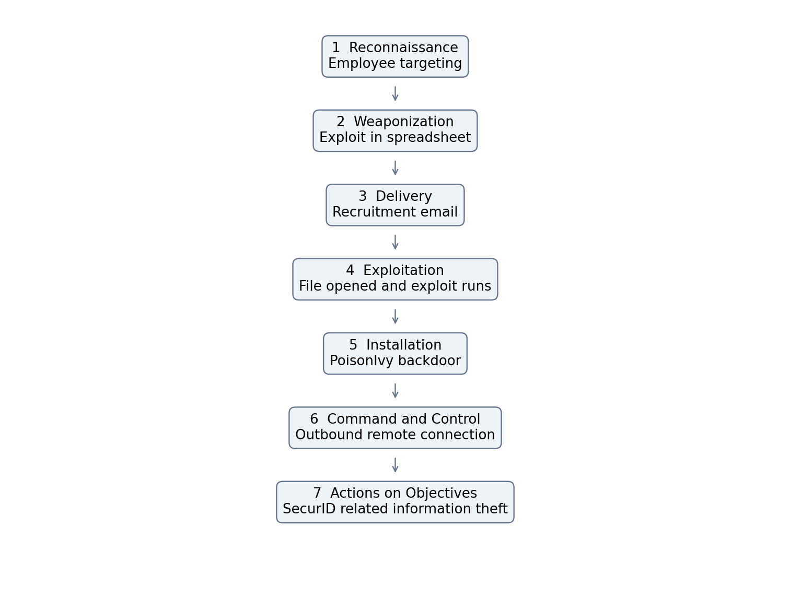

# Week 4 Cyber Kill Chain

**Project:** Detecting Spearphishing Attacks in Corporate Networks

**Student:** Danial Rahman | **Group:** CS-2421

**Course:** Introduction to Threat Hunting | **Date:** 7 October 2026

## Project topic and objective

Our group topic is Detecting Spearphishing Attacks in Corporate Networks. The project examines how a targeted email can lead to endpoint compromise and which records a defender should investigate. Week 4 uses the RSA incident from 2011 as a real case and adds a small demonstration with synthetic logs.

The syllabus requirement in Section 3.3 is to analyze a real cyberattack using the Cyber Kill Chain and map its stages to MITRE ATT&CK TTPs. This increment contains that analysis, a diagram, a mapping table and a local Python demonstration. No earlier weekly work is claimed.

## Selected real attack

In 2011, attackers targeted RSA employees with recruitment themed email and an Excel attachment. The file exploited an Adobe Flash vulnerability identified as CVE-2011-0609. This gave the attackers an entry point into the organization. [R2 R4]

A PoisonIvy variant provided remote access and connected outward to command infrastructure. Information related to RSA SecurID was stolen. The case shows why investigation should continue beyond the original email. [R3]

This report uses public descriptions. Reported means that a source describes the behavior, not that our group inspected the original incident logs. Inferred means an analytical interpretation. Software capability means that MITRE documents what PoisonIvy can do; it does not prove that capability was used in this incident.

## Frameworks and mapping limits

The Cyber Kill Chain organizes this intrusion into seven stages. MITRE ATT&CK describes adversary behavior using tactics, techniques and procedures. A tactic describes a goal, a technique describes a way of reaching it, and a procedure is the specific implementation in an incident. [R1; MITRE technique pages]

There is no universal one to one mapping. Installation is a Kill Chain stage, but ATT&CK does not have a general installation technique. The table includes related capabilities where incident evidence is incomplete. These entries are investigation leads and must not be presented as confirmed RSA procedures.

## Cyber Kill Chain and MITRE ATT&CK mapping

| Stage | Attacker activity | ATT&CK | Evidence status |
|---|---|---|---|
| Reconnaissance | Identify employee email addresses for targeting. | T1589.002 Email Addresses | Inferred. Targeting is reported; the collection method is unknown. [R2] |
| Weaponization | Prepare an Excel attachment containing a Flash exploit and malware. | T1588.001 Obtain Capabilities Malware | Related inference. PoisonIvy was used; acquisition and development are not documented. [R2 R4] |
| Delivery | Send a recruitment themed email with an Excel attachment. | T1566.001 Spearphishing Attachment | Reported behavior. [R2] |
| Exploitation | The recipient opens the file and the Flash vulnerability is exploited. | T1204.002 Malicious File; T1203 Exploitation for Client Execution | Reported behavior. CVE-2011-0609. [R2 R4] |
| Installation | Install a PoisonIvy backdoor on the compromised endpoint. | T1547.001 Registry Run Keys Startup Folder | Related software capability only. Exact RSA persistence mechanism is not established. [R3 R5] |
| Command and Control | The infected endpoint connects outward to attacker infrastructure. | T1573.001 Symmetric Cryptography | Reverse connection is reported. Encryption mapping is a PoisonIvy capability, not confirmed RSA telemetry. [R3 R5] |
| Actions on Objectives | Steal information related to SecurID. | T1005 Data from Local System | Related software capability. The exact collection location and exfiltration technique are not established here. [R3 R5] |



Figure 1. Source based analytical diagram. Stage 1 includes an inference; capability mappings in the table remain unconfirmed.

## Practical demonstration

Hypothesis: an external spreadsheet followed by an unusual Excel child process and an outbound connection on the same endpoint may deserve investigation. The demonstration correlates these records within ten minutes. It uses invented timestamps, hostnames and documentation IP addresses. It does not reproduce the Flash exploit or run malware.

Run python3 scripts/analyze_events.py from the project folder. The supplied dataset contains seven events on two endpoints. The script flags DEMO-PC-01 and leaves DEMO-PC-02 unflagged. The saved console output records the actual execution of this teaching example.

The rule is deliberately small. It does not parse real Windows logs, verify exploit execution, detect every malicious document or prove data theft. Its host and time correlation can also link unrelated events. Legitimate automation may produce similar behavior, and attacks without an Excel child process may be missed. More realistic data and process identifiers would be needed to evaluate detection performance.

```bash
python3 scripts/analyze_events.py
```

See `docs/demo_output.txt` for the recorded result.

## Detection and prevention plan

| Stage | Useful records | Proposed action |
|---|---|---|
| Delivery | Email headers and attachment metadata | Review sender authenticity and unexpected attachments; use attachment analysis. |
| Exploitation and installation | Process creation and file or registry changes | Investigate unusual document activity; restrict execution and remove unsupported components. |
| Command and Control | Endpoint network telemetry and DNS records | Correlate process activity with unfamiliar outbound destinations; review egress controls. |
| Actions on Objectives | Sensitive file access and outbound transfer records | Review unusual access and transfer volume; apply least privilege and segmentation. |

## Week 4 result and next increment

The completed increment provides a public source case analysis, a seven stage diagram, explicit ATT&CK evidence labels, a synthetic dataset and a working correlation script. The practical output is an investigation lead. It does not establish that a real corporate endpoint was compromised.

The next increment can replace the teaching records with authorized lab telemetry and compare suspicious activity with normal document workflows. Future evaluation should include false positives and missed cases.

GitHub publication is still required. The package is ready to upload, but no remote repository was supplied and no GitHub push is claimed. Commit this increment when it is reviewed, then make further commits when real changes are made. Do not backdate commits or claim earlier weekly progress.

## References

- [R1] Lockheed Martin. Cyber Kill Chain. https://www.lockheedmartin.com/en-us/capabilities/cyber/cyber-kill-chain.html
- [R2] AhnLab ASEC. Analysis of the targeted email used in the EMC RSA breach 2011. https://asec.ahnlab.com/ko/734/
- [R3] Microsoft. Security Chronicles April 14 2011. https://download.microsoft.com/download/E/5/8/E582E744-3347-40F3-B6FE-E863A5E9292E/Microsoft_Security_Chronicles_April14_2011.pdf
- [R4] Qualys. Into the Darkness Dissecting Targeted Attacks 2011. https://blog.qualys.com/vulnerabilities-threat-research/2011/11/30/dissecting-targeted-attacks
- [R5] MITRE. PoisonIvy S0012. https://attack.mitre.org/software/S0012/
- MITRE ATT&CK technique definition https://attack.mitre.org/techniques/T1589/002/
- MITRE ATT&CK technique definition https://attack.mitre.org/techniques/T1588/001/
- MITRE ATT&CK technique definition https://attack.mitre.org/techniques/T1566/001/
- MITRE ATT&CK technique definition https://attack.mitre.org/techniques/T1204/002/
- MITRE ATT&CK technique definition https://attack.mitre.org/techniques/T1203/
- MITRE ATT&CK technique definition https://attack.mitre.org/techniques/T1547/001/
- MITRE ATT&CK technique definition https://attack.mitre.org/techniques/T1573/001/
- MITRE ATT&CK technique definition https://attack.mitre.org/techniques/T1005/

References checked on 7 October 2026. Some historical pages may be unavailable; the AhnLab report and live MITRE entries provide directly readable support.
