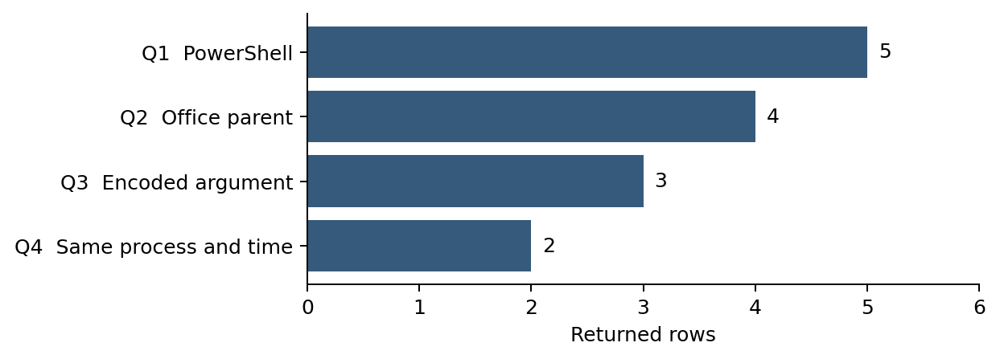

# Week 5 Hypothesis Driven Threat Hunting

## Project and weekly task

Project topic: Detecting Spearphishing Attacks in Corporate Networks. Student: Danial Rahman. Group: CS-2421. Course: Introduction to Threat Hunting. Date: 10 October 2026.

Section 3.3 of the supplied syllabus asks us to build a hypothesis-driven hunting scenario and execute hunt queries in Splunk or ELK. This increment uses Splunk Enterprise 9.4.2 to examine synthetic process and network telemetry. Four executed searches reduce five PowerShell process events to two review candidates. Analyst context then separates suspicious simulation from approved automation.

Week 4 studied a real attack through the Cyber Kill Chain. Week 5 adds a new Office and PowerShell teaching scenario. We do not attribute PowerShell activity to the RSA incident.

## Hunting model and hypothesis

An intelligence-driven hunt can start from information about a threat actor, technique or indicator. A hypothesis-driven hunt starts with a testable explanation of activity, then gathers and examines evidence. These approaches can inform each other. Our example tests a behavioral question rather than a particular threat actor or domain. [R1]

Hypothesis: an Office application may launch PowerShell with an encoded command argument, followed by an outbound connection from the same process within ten minutes. A match deserves review; it does not establish compromise.

Support criteria: Word or Excel parent, PowerShell process, selected encoded command argument, matching host and process entity identifiers, and a later outbound event within 600 seconds. Missing telemetry makes the result inconclusive. Different process identifiers or a connection outside the window weaken this specific hypothesis.

## Scope and data

The dataset contains ten synthetic events across five fictional endpoints. Each endpoint has one process event and one network event. Required fields are @timestamp, event.category, host.id, process.entity_id, process.name, process.parent.name, process.command_line and network.direction.

The encoded command is DEMO_PLACEHOLDER in a log field. No PowerShell code or malware is executed. Destination addresses come from a documentation range. The dataset contains no email telemetry, so this hunt cannot prove phishing delivery or attachment opening. In a real investigation, email and document evidence would be added.

## Search design

The four SPL searches parse JSON with spath, normalize the field names and test increasingly specific conditions. Each search uses the full ingested time range. Event time is parsed from @timestamp, rather than assuming ingestion time equals event time. [R2 R3]

Q1 finds PowerShell starts. Q2 adds a Word or Excel parent. Q3 adds the selected -enc or -EncodedCommand argument. Q4 correlates Q3 candidates with outbound traffic using host.id and process.entity_id. The complete executable queries are in queries/*.spl.

## Final correlation query

```spl
index=week5_hunt sourcetype=week5_json earliest=0 latest=now
| spath
| rename "host.id" AS host_id "event.category" AS category "process.entity_id" AS entity_id "process.name" AS process_name "process.parent.name" AS parent_name "process.command_line" AS command_line "network.direction" AS direction
| eval host_id=mvindex(host_id,0), category=mvindex(category,0), entity_id=mvindex(entity_id,0), process_name=mvindex(process_name,0), parent_name=mvindex(parent_name,0), command_line=mvindex(command_line,0), direction=mvindex(direction,0), event_time=strptime(mvindex('@timestamp',0), "%Y-%m-%dT%H:%M:%SZ")
| eval is_ps=if(in(lower(process_name), "powershell.exe", "pwsh.exe"),1,0), is_office=if(in(lower(parent_name), "winword.exe", "excel.exe"),1,0), is_encoded=if(match(lower(command_line), " -enc(odedcommand)? "),1,0)
| eval candidate_time=if(category="process" AND is_ps=1 AND is_office=1 AND is_encoded=1,event_time,null()), outbound_time=if(category="network" AND direction="egress",event_time,null())
| stats min(candidate_time) AS process_time min(outbound_time) AS network_time by host_id entity_id
| where isnotnull(process_time) AND isnotnull(network_time) AND network_time>=process_time AND network_time-process_time<=600
| eval delay_seconds=network_time-process_time
| table host_id entity_id delay_seconds
```

## How to interpret the query

candidate_time is populated only for a matching process start; outbound_time is populated only for an egress event. stats groups both record types by the same host and process entity. The final condition requires a later connection within 600 seconds.

The min aggregation is suitable for this controlled dataset, with one relevant process and network event per entity. For longer histories, an earlier network event can hide a later relevant one. Use a sequence-aware implementation or time-bounded event joins before applying this logic to production data.

## Executed evidence

The searches were executed through the local Splunk REST API against index week5_hunt with sourcetype week5_json. The recorded response files contain the returned rows. The results below are from Splunk execution, not a separate Python simulation of SPL.

The result counts describe this ten-event teaching dataset. They are not detection accuracy, precision or recall estimates for real attacks.

## Results table

| Query | Returned rows | Hosts |
|---|---|---|
| Q1 | 5 | LAB-01, LAB-02, LAB-03, LAB-04, LAB-05 |
| Q2 | 4 | LAB-01, LAB-03, LAB-04, LAB-05 |
| Q3 | 3 | LAB-01, LAB-03, LAB-04 |
| Q4 | 2 | LAB-01, LAB-03 |



## Candidate review

LAB-01 matches Office to encoded PowerShell to outbound traffic from proc-a. Its exercise context marks the workflow as unapproved. Decision: suspicious simulation requiring further investigation. A real decision would require document, script and destination review.

LAB-03 matches the same behavior through proc-c. Its exercise context identifies approved Excel reporting automation. Decision: benign matching activity. If the query were used as an alert, this example would be a false positive. The context is an exercise label, not independent evidence from an actual company.

LAB-04 has an encoded Office PowerShell event, but its outbound event belongs to an unrelated browser entity. It is excluded from Q4. LAB-02 has an Explorer parent, and LAB-05 lacks the selected encoded argument. Their exclusion only answers this hunt question; it does not establish that a real machine is safe.

## Analyst follow up

For an unapproved candidate, verify the document origin and user action; inspect the complete parent and child process tree; obtain script block content if available; check signatures and hashes; review the destination and connection history; and search for similar activity on other endpoints.

If evidence confirms an active incident, follow the organization response procedure, preserve records and escalate containment decisions. An automated hunt match alone is insufficient to justify a final malware classification.

## MITRE mapping

The scenario relates to T1059.001 PowerShell under Execution. T1204.002 Malicious File is relevant to the broader attachment scenario, but is not demonstrated by the two event categories in this dataset. The network event provides correlation context; it does not establish a specific command and control protocol. [R4 R5]

## Limitations

The rule can miss Office to cmd to PowerShell chains, other interpreters, encoded argument abbreviations outside the selected forms, or activity without a logged network event. Missing entity identifiers can prevent a reliable join. Time synchronization and consistent field extraction must be verified.

Approved automation may match. Any exception should be supported by verified owner, script identity and business purpose, and reviewed periodically. A small synthetic dataset validates intended behavior but cannot establish operational effectiveness.

## What Week 5 adds

This increment adds a hunting hypothesis, structured telemetry, four executed SPL searches, recorded query responses, analyst dispositions and a reproducible lab procedure. The optional EQL queries are provided for an Elasticsearch alternative and were not executed.

The next increment can collect authorized Windows lab telemetry and include additional benign workflows. Evaluate false positives and missed cases, then improve the correlation logic. Add these reviewed files to the same group GitHub repository as Week 4 and commit the weekly increment. No remote push is claimed in this deliverable.

## Repeat the hunt

Use an available Splunk Enterprise lab. Create index week5_hunt. Upload data/events.ndjson through Add Data as JSON lines, using sourcetype week5_json. Ensure each line becomes a separate event and confirm ten events were indexed. All timestamps fall on 10 October 2026; choose All time when reviewing the uploaded data.

Open Search and Reporting, paste each queries/*.spl search and compare results with the table. For API execution, set WEEK5_SPLUNK_URL, WEEK5_SPLUNK_USER and WEEK5_SPLUNK_PASSWORD in your local environment, then run python3 scripts/run_splunk_hunt.py. Do not commit credentials. Use a correctly trusted certificate; the optional self-signed setting in the script is restricted to localhost.

The delivered response files preserve the completed run. To defend from a phone, show the PDF query and results pages and explain the recorded run. A saved response is not a live demonstration. If the teacher requires live execution, use the group Splunk lab.

## GitHub increment

Copy the week5 folder into the group repository and follow its README. Commit after reviewing the report and query output. Later commits should reflect actual new work. No GitHub repository link was supplied, so these files have not been published remotely.

## References

- [R1] Splunk. Hypothesis Driven Hunting with the PEAK Framework. https://www.splunk.com/en_us/blog/security/peak-hypothesis-driven-threat-hunting.html
- [R2] Splunk. spath command reference. https://help.splunk.com/en/splunk-enterprise/spl-search-reference/10.2/search-commands/spath
- [R3] Splunk. Evaluation functions. https://help.splunk.com/en/splunk-enterprise/spl-search-reference/9.1/evaluation-functions/evaluation-functions
- [R4] MITRE ATTACK. PowerShell T1059.001. https://attack.mitre.org/techniques/T1059/001/
- [R5] MITRE ATTACK. Malicious File T1204.002. https://attack.mitre.org/techniques/T1204/002/
- [R6] Elastic. EQL syntax reference for optional alternative queries. https://www.elastic.co/docs/reference/query-languages/eql/eql-syntax
