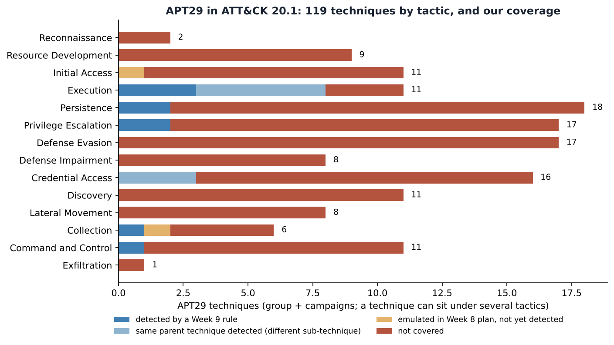
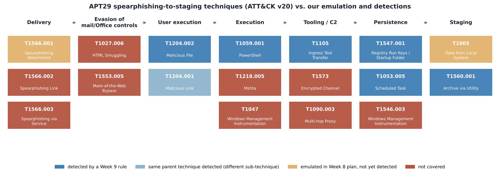

# Week 10 — Learning APT Techniques: APT29 TTPs Mapped to ATT&CK

## Project and weekly task

Project topic: Detecting Spearphishing Attacks in Corporate Networks. Student: Danial Rahman. Group: CS-2421. Course: Introduction to Threat Hunting (ITH). Assignment 6, part 2. Date: 11 November 2026.

Section 3.3 of the 2026–2027 syllabus sets the Week 10 practice task as: *analyze the TTPs of APT29 or APT41; map the observed techniques to the MITRE ATT&CK framework,* with the Mandiant APT1 report and the CrowdStrike Global Threat Report as recommended reading. We chose **APT29**, because spearphishing is its signature initial-access method and that is our project topic. We compare it briefly with APT41. The increment closes the loop on Weeks 8–9: how much of a *real* adversary does our emulation plan exercise, and how much do our detections see?

## Method and data

All technique data comes from MITRE's official **ATT&CK Enterprise 20.1 STIX bundle**. `scripts/build_apt_profile.py` extracts APT29 (G0016) into `data/apt29_profile.json`: techniques, procedure examples with their source citations, software, and attributed campaigns. It does the same for APT41 (G0096). ATT&CK records technique use at **group level** and at **campaign level** separately, so we keep the two apart. `scripts/analyze_apt29.py` then joins the profile with the Week 8 plan and the Week 9 detection results. Run log: `docs/execution_output.txt`. Full mapping of every technique: `docs/apt29_ttp_table.md`.

## APT29 at a glance

- **Attribution (ATT&CK):** Russia's Foreign Intelligence Service (SVR); active since at least 2008. Targets government networks in Europe and NATO countries, research institutes and think tanks.
- **Aliases:** IRON RITUAL, IRON HEMLOCK, NobleBaron, Dark Halo, NOBELIUM, UNC2452, YTTRIUM, The Dukes, Cozy Bear, CozyDuke, SolarStorm, Blue Kitsune, UNC3524, Midnight Blizzard.
- **Size of the profile in ATT&CK 20.1:**
  - 66 techniques at group level
  - 75 techniques in two campaigns: **C0023 Operation Ghost** (2013–2019) and **C0024 SolarWinds Compromise** (2019–2021)
  - **119 distinct techniques** in total
  - 49 software entries, including the Duke families, SUNBURST, TEARDROP, EnvyScout, Cobalt Strike and Mimikatz
- **Initial access (11 techniques):** spearphishing attachment, link and via service (T1566.001/.002/.003); valid accounts (T1078 and three sub-techniques); external remote services (T1133); exploitation of public-facing applications (T1190); supply-chain compromise (T1195.002); trusted relationships (T1199).



APT29 uses 14 of the 15 enterprise tactics in ATT&CK v20, every one except Impact. The heaviest are **Persistence (18), Privilege Escalation and Defense Evasion (17 each) and Credential Access (16)**. This is the profile of an espionage actor that values long, quiet access over fast impact: there are no Impact techniques at all.

## Case studies: how APT29 operates

The first four cases use procedure text that ATT&CK cites to vendor reporting. The fifth uses public reporting newer than the ATT&CK campaign data.

1. **The Dukes era (2008–2015): attachments and encoded PowerShell.**
   - APT29 used spearphishing emails with attachments to deliver exploits (T1566.001) and lured users into opening Word documents, PDFs and LNK files (T1204.002) (F-Secure, *The Dukes*; ESET).
   - It *"used encoded PowerShell scripts uploaded to CozyCar installations to download and install SeaDuke"* (T1059.001 + T1105; Symantec, Mandiant).
   - It persisted with **Registry Run keys** (T1547.001) and **named or hijacked scheduled tasks** (T1053.005) (Mandiant, *No Easy Breach*).
   - This is almost exactly the chain in our Week 8 plan, steps 1–6.
2. **Operation Ghost (C0023, 2013–2019).** This campaign targeted ministries of foreign affairs in Europe. It used new Duke families (PolyglotDuke, RegDuke, FatDuke), Twitter accounts and steganography for C2 (T1585.001, T1001.002), and WMI event subscriptions for persistence (T1546.003). None of these are covered by our rules.
3. **SolarWinds Compromise (C0024, 2019–2021).**
   - Initial access came through the software supply chain (T1195.002, SUNBURST), not phishing. It was followed by TEARDROP and Cobalt Strike (T1105), DCSync (T1003.006) and forged SAML tokens (T1606.002).
   - For our project the most relevant procedure is: *"APT29 used 7-Zip to compress stolen emails into password-protected archives prior to exfiltration"* (T1560.001). This is exactly Week 8 step 8, and our `w9_archive_with_password` rule detects it.
4. **NOBELIUM email campaign (May 2021).**
   - APT29 sent phishing mail through the legitimate **Constant Contact** service (T1566.003), impersonating USAID (Microsoft MSTIC; Secureworks).
   - The payload was delivered by **HTML smuggling**: an ISO embedded in an HTML attachment (T1027.006). Because the ISO and VHDX containers strip Mark-of-the-Web (T1553.005), Office macro blocking never applies.
5. **Recent tradecraft (public reporting, not yet in ATT&CK campaign data).**
   - In January 2024 Microsoft disclosed that Midnight Blizzard had accessed corporate mailboxes after a **password spray** against a legacy test tenant (T1110.003, T1078.004).
   - In October 2024 Microsoft reported a large spearphishing campaign that used **signed .rdp attachments** (T1566.001) to connect victims to attacker-controlled RDP servers.
   - Both bypass a macro-centred detection strategy completely.

## Mapping our project onto APT29



**Emulation plan (Week 8).** **8 of our 11 plan techniques are used by APT29**: T1005, T1053.005, T1059.001, T1105, T1204.002, T1547.001, T1560.001 and T1566.001. The other three are not attributed to APT29 in ATT&CK:

- **T1003.001 LSASS Memory.** APT29 dumps credentials differently: `reg save` of the SAM and LSA secrets (T1003.002/.004) and DCSync (T1003.006).
- **T1041 Exfiltration Over C2 Channel.** APT29 used HTTPS to an archive staged on OWA (T1048.002).
- **T1027.010 Command Obfuscation.**

These are useful corrections for a second version of the plan that is closer to APT29.

**Detection coverage (Week 9)** of the 119 APT29 techniques:

| Coverage | Techniques |
|---|---|
| Detected by a Week 9 rule | 6 (T1059.001, T1053.005, T1547.001, T1105, T1204.002, T1560.001) |
| Same parent technique detected, different sub-technique (e.g. T1003.002, T1059.003, T1204.001) | 8 |
| Emulated but not yet detected (T1566.001 delivery, T1005) | 2 |
| Not covered | 103 |

Only **about 12% of APT29** is detected or adjacent to a detection. That is the honest result of a project that focused on one intrusion path. The covered part is APT29's *older, endpoint-centred* phishing chain. Its *modern* tradecraft is almost entirely uncovered: cloud and identity techniques such as T1078.004, T1098.*, T1528, T1606.* and T1621, supply chain (T1195.002), and container-based delivery (T1027.006, T1553.005).

`attack/apt29_coverage_layer.json` is an ATT&CK Navigator layer of all 119 techniques, coloured by this coverage. It can be loaded next to the Week 8 and Week 9 layers.

## APT29 vs APT41 (comparison)

APT41 (G0096; Wicked Panda, Brass Typhoon, BARIUM) has 82 techniques in ATT&CK 20.1. It shares **19 techniques** with APT29 at group level (Jaccard similarity 0.15), including:

- T1566.001 spearphishing attachment
- T1059.001 PowerShell
- T1053.005 scheduled task
- T1547.001 Run keys
- T1105 ingress tool transfer
- T1078 valid accounts
- T1190 exploitation of public-facing applications
- T1047 WMI

The overlap is mostly the **commodity layer** of Windows intrusion. APT41's dual espionage and financial mission shows up as Impact and many more Discovery techniques, while APT29 leans towards identity and cloud. For a defender this is good news: **5 of our 6 detected techniques are also APT41 techniques** (all except T1204.002 Malicious File), so the Week 9 rules transfer across both groups.

## Recommended next hunts

These are uncovered APT29 techniques with the highest value for a spearphishing-focused hunt. This prioritisation is analyst judgement; the techniques themselves come from ATT&CK.

| # | Technique | Data source needed | Why |
|---|---|---|---|
| 1 | T1566.002 Spearphishing Link | proxy/DNS + Sysmon 11 (zip/iso in Downloads) | APT29's most-cited delivery method; we only emulate attachments |
| 2 | T1027.006 HTML Smuggling | Sysmon 11: .iso/.img/.vhdx written by a browser right after an .html opens | NOBELIUM 2021 (EnvyScout) |
| 3 | T1553.005 Mark-of-the-Web Bypass | Sysmon 1/11: execution from a mounted ISO/VHDX volume | defeats Office macro blocking |
| 4 | T1218.005 Mshta | Sysmon 1: mshta.exe with http/javascript arguments | in our Office-child list, but needs a standalone rule |
| 5 | T1546.003 WMI Event Subscription | Sysmon 19/20/21 | used in Operation Ghost and SolarWinds |
| 6 | T1078 Valid Accounts | 4624/4625, VPN and Entra ID sign-in logs | APT29 often skips phishing with password spray + valid accounts |

## Conclusions across Weeks 8–10

1. **A written plan is a set of predictions, and the Atomic run disproved two of them** (Week 7 tuned PowerShell rule and CAR-2013-02-003). Without emulation those rules would still be considered "coverage".
2. **ATT&CK makes the gap measurable.** Our detections are good for the classic Dukes-era phishing chain, but that chain is only about 12% of what APT29 does today.
3. **The next increment should move left and sideways:** cover the delivery containers (HTML smuggling, ISO, RDP files) and the identity plane (password spray, token theft), where APT29 has moved.

## Limitations

- ATT&CK records only *publicly reported* procedures, so the absence of a technique does not mean APT29 never uses it. For example, ATT&CK does not attribute T1041 to APT29, but reporting may exist that ATT&CK has not added yet.
- Campaign-level data exists only for C0023 and C0024. The 2023–2024 activity is described from Microsoft reporting, not from ATT&CK.
- Coverage is measured against our synthetic Week 9 run. A real lab run could move individual techniques between categories.

## Reproduce

```bash
cd week10
python3 -m pip install pyyaml matplotlib
# optional, refreshes data/*.json from MITRE's STIX bundle:
python3 scripts/build_apt_profile.py /path/to/enterprise-attack.json
python3 scripts/analyze_apt29.py      # reads ../week8 plan and ../week9 results
```

## References

- [R1] MITRE ATT&CK: APT29 (G0016). https://attack.mitre.org/groups/G0016/ ; Operation Ghost (C0023), SolarWinds Compromise (C0024). STIX data: https://github.com/mitre-attack/attack-stix-data
- [R2] MITRE ATT&CK: APT41 (G0096). https://attack.mitre.org/groups/G0096/
- [R3] F-Secure, *The Dukes: 7 years of Russian cyberespionage*. https://www.f-secure.com/documents/996508/1030745/dukes_whitepaper.pdf
- [R4] Mandiant, *No Easy Breach* (DerbyCon 2016). https://www.slideshare.net/slideshow/no-easy-breach-derby-con-2016/66447908
- [R5] Microsoft MSTIC, *New sophisticated email-based attack from NOBELIUM* (27 May 2021). https://www.microsoft.com/security/blog/2021/05/27/new-sophisticated-email-based-attack-from-nobelium/
- [R6] ESET Threat Report T3 2021. https://www.welivesecurity.com/wp-content/uploads/2022/02/eset_threat_report_t32021.pdf
- [R7] Microsoft MSRC, *Microsoft actions following attack by nation state actor Midnight Blizzard* (19 Jan 2024). https://msrc.microsoft.com/blog/2024/01/microsoft-actions-following-attack-by-nation-state-actor-midnight-blizzard/
- [R8] Microsoft Threat Intelligence, *Midnight Blizzard conducts large-scale spear-phishing campaign using RDP files* (29 Oct 2024). https://www.microsoft.com/en-us/security/blog/2024/10/29/midnight-blizzard-conducts-large-scale-spear-phishing-campaign-using-rdp-files/
- [R9] Mandiant, *APT1: Exposing One of China's Cyber Espionage Units* (2013), syllabus reading, used for the report structure. CrowdStrike Global Threat Report (syllabus reading).
