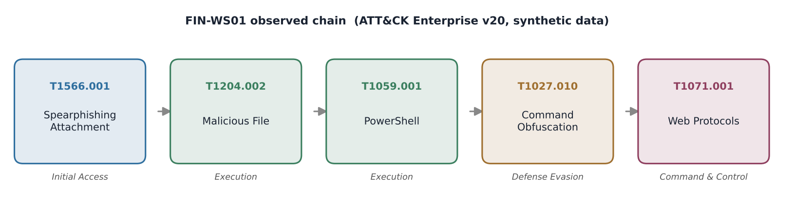
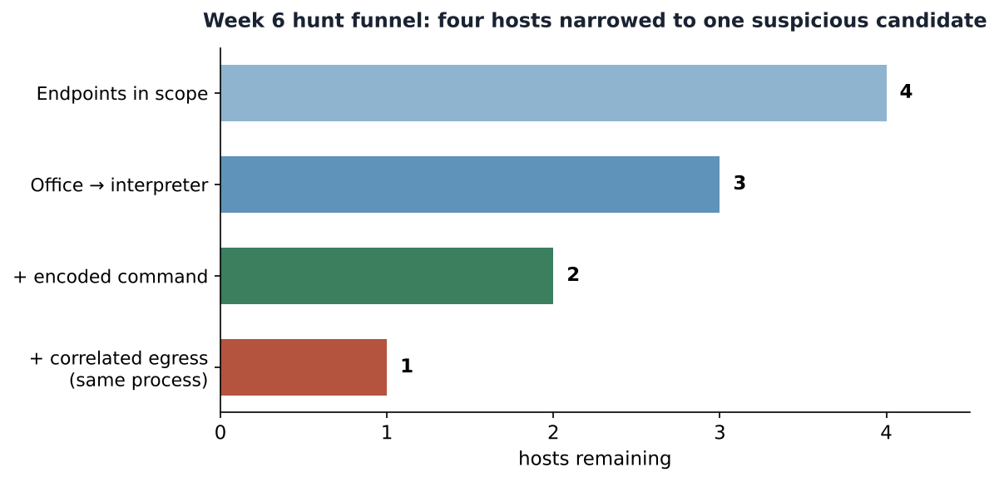

# Week 6 — ATT&CK Framework: Mapping a Spearphishing Attachment Chain

## Project and weekly task

Project topic: Detecting Spearphishing Attacks in Corporate Networks. Student: Danial Rahman. Group: CS-2421. Course: Introduction to Threat Hunting (ITH). Date: 24 October 2026.

Section 3.3 of the 2026–2027 syllabus sets the Week 6 practice task as: *study one specific ATT&CK technique (e.g. T1059 — Command-Line Interface), simulate an attack and map the results to ATT&CK tactics and techniques,* with the MITRE ATT&CK Navigator documentation as recommended reading. This increment applies that task to our group topic. The technique we study in depth is **T1566.001 — Spearphishing Attachment**, and we follow it through the execution chain it triggers so the mapping covers a full initial-access-to-C2 sequence rather than a single cell.

Week 4 organised the RSA breach with the Cyber Kill Chain; Week 5 built a hypothesis-driven PowerShell hunt in Splunk. Week 6 keeps the same phishing theme but moves to the ATT&CK framework: we describe a technique precisely, generate synthetic telemetry for it, and produce an ATT&CK Navigator layer. All data is synthetic and nothing is executed (see *Safety and scope*).

## The ATT&CK framework in brief

ATT&CK organises adversary behaviour into **tactics** (the attacker's goal — e.g. Initial Access, Execution), **techniques** (how the goal is achieved — e.g. Spearphishing Attachment), **sub-techniques** (specific variants), and **procedures** (concrete in-the-wild implementations). We use **Enterprise ATT&CK v20**, read directly from MITRE's official STIX bundle; the facts below (names, tactics, group counts, mitigations, detection strategies) are extracted by `scripts/build_attack_reference.py` into `data/attack_v20_subset.json` so they are verifiable and reproducible, not quoted from memory.

> Note on tactic naming: in ATT&CK v20 the tactic that earlier versions called *Defense Evasion* is represented in the STIX data under the shortname `stealth`. We use the familiar label "Defense Evasion" in prose and figures.

## Technique studied: T1566.001 — Spearphishing Attachment

- **Tactic:** Initial Access (TA0001)
- **ATT&CK version:** 2.2 · **URL:** https://attack.mitre.org/techniques/T1566/001/
- **Description (MITRE):** adversaries send spearphishing emails with a malicious attachment to gain access to victim systems. The attachment (an Office document, executable, PDF or archive) relies on **User Execution (T1204.002)** after the recipient opens it.
- **Prevalence:** attributed to **79 named groups** and **62 pieces of software** in ATT&CK v20 — among the most widely used initial-access techniques, which is why it anchors our project.
- **Mitigations (MITRE):** M1017 User Training, M1018 User Account Management, M1021 Restrict Web-Based Content, M1031 Network Intrusion Prevention, M1047 Audit, M1049 Antivirus/Antimalware, M1054 Software Configuration.
- **MITRE detection strategy DET0236** correlates *inbound email metadata → attachment on disk → process execution → outbound network activity* — exactly the behavioural chain our hunt reconstructs. Its Windows analytic (AN0655) names the log sources we model: mail-gateway content, Sysmon EventCode 11 (file create), EventCode 1 (process create) and EventCode 3/22 (network/DNS).

## The simulated attack chain

We model one suspicious host (**FIN-WS01**) carried through five ATT&CK techniques, plus three control hosts that look similar but must not be confused with the attack.

| # | Observed step (synthetic) | Technique | Tactic |
|---|---|---|---|
| 1 | Mail gateway delivers a macro-document attachment; sender fails SPF/DMARC | **T1566.001** Spearphishing Attachment | Initial Access |
| 2 | User opens the document; WINWORD.EXE writes it to `\Downloads\` and spawns a child | **T1204.002** Malicious File | Execution |
| 3 | The child process is `powershell.exe` | **T1059.001** PowerShell | Execution |
| 4 | Its command line carries an `-EncodedCommand` argument | **T1027.010** Command Obfuscation | Defense Evasion |
| 5 | The *same* PowerShell process opens an outbound TCP/443 session | **T1071.001** Web Protocols | Command & Control |

This is the mapping the syllabus asks for: each observed artefact is tied to a specific ATT&CK technique and its tactic, forming a path across the matrix rather than a single technique in isolation.

## Safety and scope

Nothing in this increment is live or dangerous:

- **No email is generated.** Mail activity is represented as mail-gateway *log records* (`data/mail_events.ndjson`) — sender, recipient, SPF/DKIM/DMARC verdict and an attachment name plus the SHA-256 of a short harmless placeholder string. There is no message body, no macro, no script and no attachment file.
- **No process runs and no connection is made.** Endpoint activity is synthetic telemetry in the Sysmon schema (`data/endpoint_events.ndjson`, EventID 1/3/11). The "encoded command" values are short Base64 of harmless placeholder text.
- **Nothing resolves or routes.** Senders use the reserved `.example` TLD; all IPs are from the RFC 5737 documentation ranges (`192.0.2.0/24`, `198.51.100.0/24`, `203.0.113.0/24`).

The generator is deterministic, so every figure and count in this report is reproducible with `python3 scripts/generate_telemetry.py`.

## The hunt: narrowing four hosts to one candidate

`scripts/hunt_and_map.py` reads the telemetry and applies the DET0236 logic: mail reputation → Office writes a document → Office spawns an interpreter → encoded argument → **egress from the same process entity**. The last condition is the key discriminator and reuses the process-correlation lesson from Week 5.

| Host | Disposition | Techniques mapped |
|---|---|---|
| **FIN-WS01** | **SUSPICIOUS** — full delivery-to-C2 chain, investigate | T1566.001, T1204.002, T1059.001, T1027.010, T1071.001 |
| FIN-WS02 | BENIGN — no Office→interpreter chain (PDF opened from Explorer) | none |
| FIN-WS03 | BENIGN MATCH — Excel→PowerShell but no encoding, internal destination; approved automation | T1204.002, T1059.001 |
| FIN-WS04 | PARTIAL — encoded Office PowerShell, but outbound traffic belonged to a *different* process | T1204.002, T1059.001, T1027.010 |

FIN-WS03 and FIN-WS04 are deliberate controls. FIN-WS03 shows that "Office spawned PowerShell" alone is a false positive (approved reporting automation). FIN-WS04 shows why host-only correlation is too broad: the encoded PowerShell and the outbound connection are real, but they are not the *same* process, so FIN-WS04 is excluded from the C2 step. Only FIN-WS01 satisfies the complete chain.

## ATT&CK Navigator layer

`attack/navigator_layer.json` is a valid Navigator 4.5 layer (ATT&CK v20). Each technique is scored by the number of synthetic hosts exhibiting it, so the attack path lights up on the matrix. To view it: open [ATT&CK Navigator](https://mitre-attack.github.io/attack-navigator/) → *Open Existing Layer* → *Upload from local* → select the file.

## Limitations

The dataset has four hosts and a single attack path; the counts show that the logic behaves as intended, not detection accuracy. A real spearphishing hunt would add the email body, attachment detonation, document-macro telemetry, DNS and proxy logs, and would treat `-EncodedCommand` as one indicator among many (legitimate tools also encode commands). The mapping reflects our modelled chain; an attacker could reach the same tactics through other techniques (e.g. T1566.002 link-based delivery, or `mshta`/`regsvr32` execution).

## What Week 6 adds to the project

A precise ATT&CK technique study grounded in the official v20 STIX data, a safe synthetic telemetry set for a spearphishing chain, a reproducible hunt that maps observations to five techniques across four tactics, two figures, and an importable Navigator layer. Week 7 implements MITRE CAR analytics that detect the execution stage of this same chain in a SIEM.

## References

- [R1] MITRE ATT&CK — Spearphishing Attachment T1566.001. https://attack.mitre.org/techniques/T1566/001/
- [R2] MITRE ATT&CK — User Execution: Malicious File T1204.002. https://attack.mitre.org/techniques/T1204/002/
- [R3] MITRE ATT&CK — PowerShell T1059.001. https://attack.mitre.org/techniques/T1059/001/
- [R4] MITRE ATT&CK — Command Obfuscation T1027.010. https://attack.mitre.org/techniques/T1027/010/
- [R5] MITRE ATT&CK — Web Protocols T1071.001. https://attack.mitre.org/techniques/T1071/001/
- [R6] MITRE ATT&CK Navigator. https://mitre-attack.github.io/attack-navigator/
- [R7] MITRE ATT&CK STIX data (enterprise-attack v20). https://github.com/mitre-attack/attack-stix-data
- [R8] RFC 5737 — IPv4 Address Blocks Reserved for Documentation. https://datatracker.ietf.org/doc/html/rfc5737
