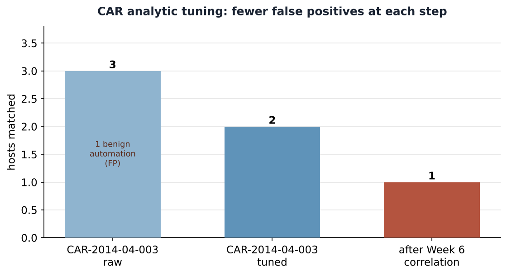

# Week 7 — Using MITRE CAR: Implementing and Executing Analytics in a SIEM

## Project and weekly task

Project topic: Detecting Spearphishing Attacks in Corporate Networks. Student: Danial Rahman. Group: CS-2421. Course: Introduction to Threat Hunting (ITH). Date: 24 October 2026.

Section 3.3 of the 2026–2027 syllabus sets the Week 7 practice task as: *select an analytic model from CAR and implement it in a SIEM; map the analytic to related ATT&CK techniques,* with the MITRE CAR documentation as recommended reading. This increment selects two analytics from the **MITRE Cyber Analytics Repository (CAR)**, implements them as portable Sigma rules, **converts them to Splunk SPL and SQLite with pySigma, and executes the SQLite form against a log store** built from the Week 6 telemetry. It then maps each analytic back to ATT&CK v20.

This continues the same phishing chain: Week 6 mapped the *behaviour* (T1566.001 → … → T1071.001); Week 7 builds the *detections* for its execution stage and shows how raw CAR analytics are tuned to cut false positives.

## Analytics vs detections

CAR distinguishes an **analytic** (a documented, data-model-based hunting idea, often vendor-neutral pseudocode) from a **detection** (a concrete query that runs in one product). The syllabus task is to take the analytic and realise it as a detection in a SIEM. We make that bridge explicit with a pipeline:

```
MITRE CAR analytic  ->  Sigma rule (rules/*.yml)  ->  pySigma backend  ->  SPL (Splunk)  +  SQLite  ->  executed results
```

Writing the rule once in Sigma and converting it means the same analytic runs in Splunk (the group lab) and in a local SQLite store (reproducible here with no SIEM licence).

## Analytics selected

**CAR-2014-04-003 — PowerShell Execution** (https://car.mitre.org/analytics/CAR-2014-04-003/). CAR's pseudocode is: `filter processes where exe == "powershell.exe" AND parent_exe != "explorer.exe"`. It maps to **T1059.001 (PowerShell)** and is deliberately broad. We implement it in two forms:

- `rules/car_2014_04_003_powershell.yml` — the **raw** analytic, faithful to the CAR pseudocode.
- `rules/car_2014_04_003_powershell_tuned.yml` — a **tuned** variant that keeps only an Office parent **and** an encoded-command argument, adding coverage of **T1027.010 (Command Obfuscation)** and **T1204.002 (Malicious File)**. This is the detection aligned to our phishing chain.

**CAR-2013-02-003 — Processes Spawning cmd.exe** (https://car.mitre.org/analytics/CAR-2013-02-003/). CAR notes that when a document or mail reader launches `cmd.exe` it "may suggest that a malicious document has been loaded." `rules/car_2013_02_003_cmd_parent.yml` keeps `cmd.exe` with an Office/reader parent, covering **T1059.003 (Windows Command Shell)** for the Office→cmd→PowerShell variant of the attack.

## Conversion with pySigma

`scripts/convert_rules.py` loads each rule, applies the Sysmon pipeline for the Splunk output, and writes `queries/*.spl` and `queries/*.sql`. Representative output:

Raw CAR-2014-04-003, Splunk:
```spl
EventID=1 Image="*\\powershell.exe" NOT ParentImage="*\\explorer.exe"
```
Tuned CAR-2014-04-003, Splunk:
```spl
EventID=1 Image="*\\powershell.exe"
  ParentImage IN ("*\\WINWORD.EXE", "*\\EXCEL.EXE", "*\\POWERPNT.EXE")
  CommandLine IN ("* -enc *", "* -enc*", "*-EncodedCommand*")
```
Tuned CAR-2014-04-003, SQLite (executed here):
```sql
SELECT * FROM logs WHERE EventID=1
  AND (Image LIKE '%\powershell.exe' ESCAPE '\'
  AND (ParentImage LIKE '%\WINWORD.EXE' ESCAPE '\' OR ParentImage LIKE '%\EXCEL.EXE' ESCAPE '\'
       OR ParentImage LIKE '%\POWERPNT.EXE' ESCAPE '\')
  AND (CommandLine LIKE '% -enc %' ESCAPE '\' OR CommandLine LIKE '% -enc%' ESCAPE '\'
       OR CommandLine LIKE '%-EncodedCommand%' ESCAPE '\'))
```

Backend and pipeline versions are recorded in `docs/conversion.json`.

## Execution

`scripts/run_hunt.py` builds an in-memory SQLite table from the Sysmon-schema `data/endpoint_events.ndjson` (4 process-creation records across FIN-WS01–04), loads each committed `queries/*.sql`, and runs it. This is real query execution against a real data store, not a hand-written simulation of query behaviour. Full log: `docs/execution_output.txt`.

| Analytic | Rows | Hosts matched |
|---|---|---|
| CAR-2014-04-003 **raw** | 3 | FIN-WS01, FIN-WS03, FIN-WS04 |
| CAR-2014-04-003 **tuned** | 2 | FIN-WS01, FIN-WS04 |
| CAR-2013-02-003 (cmd variant) | 0 | none |



## Interpretation: tuning removes false positives

The raw analytic matches **three** hosts, including **FIN-WS03** — approved Excel reporting automation (`svc_report` running a signed `.ps1` to an internal file server). Treated as an alert, that is a false positive. The **tuned** analytic requires an Office parent *and* an encoded command, dropping FIN-WS03 and leaving **FIN-WS01** and **FIN-WS04**.

FIN-WS04 still matches the tuned rule because, at the single-process-event level, it genuinely is encoded PowerShell launched by Word. It is only dismissed by the **Week 6 correlation step**: its outbound connection belonged to a different process (chrome.exe), so it never completes the chain. This is the lesson the three increments build toward — a single analytic finds *candidates*; correlation and analyst context resolve them. Raw 3 → tuned 2 → correlated 1 is the funnel.

CAR-2013-02-003 returns zero rows here because the simulated chain used PowerShell rather than `cmd.exe`. It is kept deliberately as coverage for the Office→cmd→PowerShell variant; a zero-row analytic that encodes a real hypothesis is still a useful part of a detection set.

## ATT&CK mapping and coverage layer

| Analytic | ATT&CK techniques |
|---|---|
| CAR-2014-04-003 raw | T1059.001 |
| CAR-2014-04-003 tuned | T1059.001, T1027.010, T1204.002 |
| CAR-2013-02-003 | T1059.003, T1204.002 |

`attack/navigator_layer.json` is an importable ATT&CK Navigator layer (v20) showing this coverage. It overlaps the Week 6 layer on the Execution tactic, which is the point: Week 6 maps the adversary behaviour, Week 7 maps what our analytics actually detect.

## Limitations

The SQLite store holds four synthetic records, so the row counts demonstrate rule logic and tuning effect, not real-world precision or recall. The SPL is generated for a standard Sysmon index and should be validated in the group's Splunk lab against real field extractions before use. Pattern-matching on `-enc` catches only the abbreviations listed; real obfuscation detection needs deobfuscation and script-block logging (EventID 4104). The analytics cover the execution stage of one chain; full spearphishing detection also needs mail, file-create and network analytics (the Week 6 DET0236 strategy).

## Reproduce

```bash
cd week7
python3 -m pip install "pysigma>=1.5,<2" "pysigma-backend-splunk>=1.1,<2" \
    "pysigma-backend-sqlite>=2.1,<3" "pysigma-pipeline-sysmon>=1,<2" "pysigma-pipeline-windows>=1,<2"
python3 scripts/convert_rules.py     # rules -> queries/*.spl + queries/*.sql
python3 scripts/run_hunt.py          # execute SQLite queries, write docs/*
python3 scripts/make_figures.py      # render figure + Navigator layer
```
For the Splunk lab: ingest `data/endpoint_events.ndjson` into a Sysmon index and paste `queries/*.spl` into Search & Reporting. Do not present saved results as a live run.

## References

- [R1] MITRE CAR — CAR-2014-04-003 PowerShell Execution. https://car.mitre.org/analytics/CAR-2014-04-003/
- [R2] MITRE CAR — CAR-2013-02-003 Processes Spawning cmd.exe. https://car.mitre.org/analytics/CAR-2013-02-003/
- [R3] MITRE CAR documentation. https://car.mitre.org/
- [R4] Sigma — generic signature format. https://github.com/SigmaHQ/sigma
- [R5] pySigma. https://github.com/SigmaHQ/pySigma
- [R6] MITRE ATT&CK — T1059.001, T1059.003, T1027.010, T1204.002. https://attack.mitre.org/
- [R7] MITRE ATT&CK Navigator. https://mitre-attack.github.io/attack-navigator/
