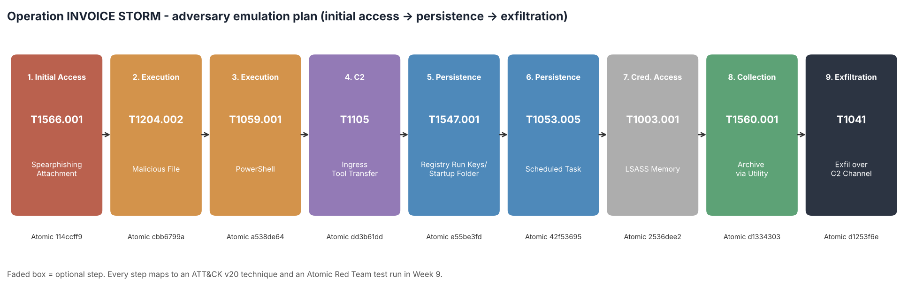

# Week 8 — Creating a Plan to Emulate an Attacker's Actions

## Project and weekly task

Project topic: Detecting Spearphishing Attacks in Corporate Networks. Student: Danial Rahman. Group: CS-2421. Course: Introduction to Threat Hunting (ITH). Assignment 5. Date: 1 November 2026.

Section 3.3 of the 2026–2027 syllabus sets the Week 8 practice task as: *develop a simple adversary emulation plan (initial access → persistence → data exfiltration); document the plan using ATT&CK techniques,* with the MITRE CALDERA documentation as recommended reading.

Weeks 4–7 described, hunted and detected **one stage** of a phishing intrusion: the Office macro that launches encoded PowerShell. This increment writes down the **whole intrusion** as an emulation plan the group can run in its lab. Every step is an ATT&CK v20 technique tied to a concrete Atomic Red Team test. Week 9 runs the plan. Week 10 compares it with a real APT group.

## What adversary emulation is

Adversary emulation means replaying a real adversary's **behaviours** (TTPs) in a controlled environment so defenders can measure whether they see each one. It is different from a penetration test, which tries to reach a goal by any route. MITRE's emulation plans and CALDERA use the same structure: a threat profile built from CTI, an ordered list of ATT&CK techniques with concrete procedures, rules of engagement, and a way to score detection step by step. Our plan follows that structure. It is stored as machine-readable YAML (`plan/emulation_plan.yaml`), so it can be validated and turned into a CALDERA adversary profile automatically.

## Threat profile

We emulate a **financially themed spearphishing intrusion against the Finance department**. The tradecraft is modelled on APT29 (G0016). APT29 is a well-documented spearphishing actor, and Week 10 analyses it in depth. The plan reduces that tradecraft to commodity tooling and does not reproduce APT29 malware. Facts read from the ATT&CK v20 STIX bundle (`data/attack_v20_subset.json`):

- 7 of the 11 plan techniques are mapped to APT29 at group level in ATT&CK v20: T1566.001, T1204.002, T1059.001, T1105, T1547.001, T1053.005 and T1005.
- An 8th technique, **T1560.001**, is recorded in APT29's SolarWinds campaign (C0024): *"APT29 used 7-Zip to compress stolen emails into password-protected archives prior to exfiltration"*. Step 8 emulates exactly this.
- **T1003.001 (LSASS dumping)** and **T1041 (exfiltration over C2)** are not attributed to APT29 in ATT&CK. We keep them because the syllabus names T1003 for Week 9 and asks for an exfiltration stage. Both are widely used: 44 and 28 groups respectively.

## The plan: Operation INVOICE STORM



| # | Tactic | Technique | Atomic test (GUID) | Expected detection | APT29 uses (ATT&CK v20) |
|---|---|---|---|---|---|
| 1 | Initial Access | T1566.001 Spearphishing Attachment | T1566.001 #1 Download Macro-Enabled Phishing Attachment (`114ccff9`) | Week 6 mail filter (macro attachment + SPF/DMARC fail) | yes |
| 2 | Execution | T1204.002 Malicious File | T1566.001 #2 Word spawned a command shell and used an IP address in the command line (`cbb6799a`) | CAR-2013-02-003 (Week 7) - Office spawning a shell | yes |
| 3 | Execution | T1059.001 PowerShell + T1027.010 | T1059.001 #17 PowerShell Command Execution (`a538de64`) | CAR-2014-04-003 raw and tuned (Week 7) | yes |
| 4 | Command and Control | T1105 Ingress Tool Transfer | T1105 #7 certutil download (urlcache) (`dd3b61dd`) | New Week 9 rule (certutil download) | yes |
| 5 | Persistence | T1547.001 Registry Run Keys / Startup Folder | T1547.001 #1 Reg Key Run (`e55be3fd`) | New Week 9 rule (Run key written by a script host / reg.exe) | yes |
| 6 | Persistence | T1053.005 Scheduled Task | T1053.005 #2 Scheduled task Local (`42f53695`) | New Week 9 rule (schtasks /create from a shell) | yes |
| 7 | Credential Access | T1003.001 LSASS Memory *(optional)* | T1003.001 #2 Dump LSASS.exe Memory using comsvcs.dll (`2536dee2`) | New Week 9 rule (comsvcs MiniDump) | no |
| 8 | Collection | T1560.001 Archive via Utility + T1005 | T1560.001 #4 Compress Data and lock with password for Exfiltration with 7zip (`d1334303`) | New Week 9 rule (archiver with password switch) | no* |
| 9 | Exfiltration | T1041 Exfiltration Over C2 Channel | T1041 #1 C2 Data Exfiltration (`d1253f6e`) | Week 6 same-process egress correlation; new Week 9 network rule | no |

\*T1560.001 is not attributed to APT29 at group level, but it is recorded in APT29's SolarWinds campaign (C0024).

The table is generated from the YAML (`docs/plan_matrix.md`). The syllabus asks for the chain *initial access → persistence → data exfiltration*. Steps 1, 5–6 and 9 are those three stages. The other steps (execution, tool transfer, credential access, staging) are what a real intrusion needs to connect them.

For each step the plan also records:

- **Procedure**: what the red team does, in plain words.
- **Expected telemetry**: the Sysmon events and EventIDs the step should produce (1, 3, 10, 11, 13), plus Security 4698 and PowerShell 4104.
- **Expected detection**: which hunt or analytic from Weeks 5–7 should fire. "New Week 9 rule" means we expected no existing coverage. Writing this down *before* the run is the purpose of the plan: Week 9 checks each prediction.
- **Success criterion and cleanup command**: so every step can be verified and reverted.

## Rules of engagement, roles and scope

- **Scope.** One isolated Windows 10 VM, `LAB-WIN10-01`, with Sysmon 15 and the Splunk Universal Forwarder; a test mailbox; and a Kali "C2" on the lab's simulated-internet segment (198.51.100.25:8080). No production host, mailbox or credential is in scope.
- **Safety.** Snapshot before the run and revert afterwards. Every step has a cleanup command. Abort if traffic leaves the lab VLAN. The LSASS step is optional, runs only on the lab VM, and its dump file is deleted immediately.
- **Roles.** The *red* student executes and logs UTC start and stop times for each step. The *blue* student hunts in Splunk without knowing the order of the steps. The *white cell* (practice teacher) approves the window and arbitrates the results.
- **Pacing.** About 5 minutes between steps, so each step is separable on the SIEM timeline. Week 9 uses these windows to attribute detections to steps.

## Automation: validating the plan and exporting it to CALDERA

`scripts/validate_plan.py` treats the plan as code. Full log: `docs/validation_output.txt`.

1. Every technique exists and is current in ATT&CK **20.1** (read from the official STIX bundle by `scripts/build_attack_reference.py`).
2. The tactic each step claims really is one of that technique's tactics. For example, T1053.005 is valid under Execution, Persistence and Privilege Escalation, and we use Persistence.
3. The plan starts with Initial Access and ends with Exfiltration, and every step has an Atomic GUID, a cleanup command and an expected detection.

**Result: PASS**, with one NOTE. Step 5 (Persistence) comes after step 4 (Command and Control), which is further right in the ATT&CK matrix. A first version of the validator treated this as an error. That was wrong: ATT&CK tactics are **not a linear kill chain**, and real intruders download their second stage before installing persistence. The check now logs this as a note. This is a useful difference from the Week 4 Cyber Kill Chain.

The same script writes:

- `plan/caldera_adversary.yml`: a CALDERA adversary profile whose `atomic_ordering` lists the nine Atomic GUIDs. CALDERA's *atomic* plugin names imported abilities by these GUIDs, so the profile can be loaded into CALDERA and run as an operation against an agent on the lab VM.
- `attack/navigator_layer.json`: an ATT&CK Navigator layer of the plan, with score equal to the step number.
- `images/emulation_flow.png`: the flow figure above.

## Limitations

- The plan emulates *behaviours* with Atomic tests and built-in binaries. It does not reproduce APT29's custom tooling (EnvyScout, WINELOADER and so on), its HTML smuggling, or its cloud and identity tradecraft. Week 10 lists these as gaps.
- Step 1 uses the Atomic test's PowerShell download of a macro workbook as a stand-in for mail delivery. A real phishing email arrives through Outlook, and Week 9 shows why this difference matters.
- The CALDERA profile needs the atomic plugin and a Sandcat agent on the lab VM. We have not run it through CALDERA; Week 9 runs the same tests with Invoke-AtomicRedTeam.

## Reproduce

```bash
cd week8
python3 -m pip install pyyaml matplotlib
# optional, refreshes data/attack_v20_subset.json from MITRE's STIX bundle:
python3 scripts/build_attack_reference.py /path/to/enterprise-attack.json
python3 scripts/validate_plan.py     # checks + CALDERA profile + Navigator layer + figure
```

## References

- [R1] MITRE ATT&CK Enterprise v20 STIX data. https://github.com/mitre-attack/attack-stix-data
- [R2] MITRE CALDERA documentation: adversaries, abilities, atomic plugin. https://caldera.readthedocs.io/
- [R3] MITRE Center for Threat-Informed Defense: Adversary Emulation Library. https://github.com/center-for-threat-informed-defense/adversary_emulation_library
- [R4] Red Canary: Atomic Red Team. https://github.com/redcanaryco/atomic-red-team
- [R5] MITRE ATT&CK: APT29 (G0016), SolarWinds Compromise (C0024). https://attack.mitre.org/groups/G0016/
